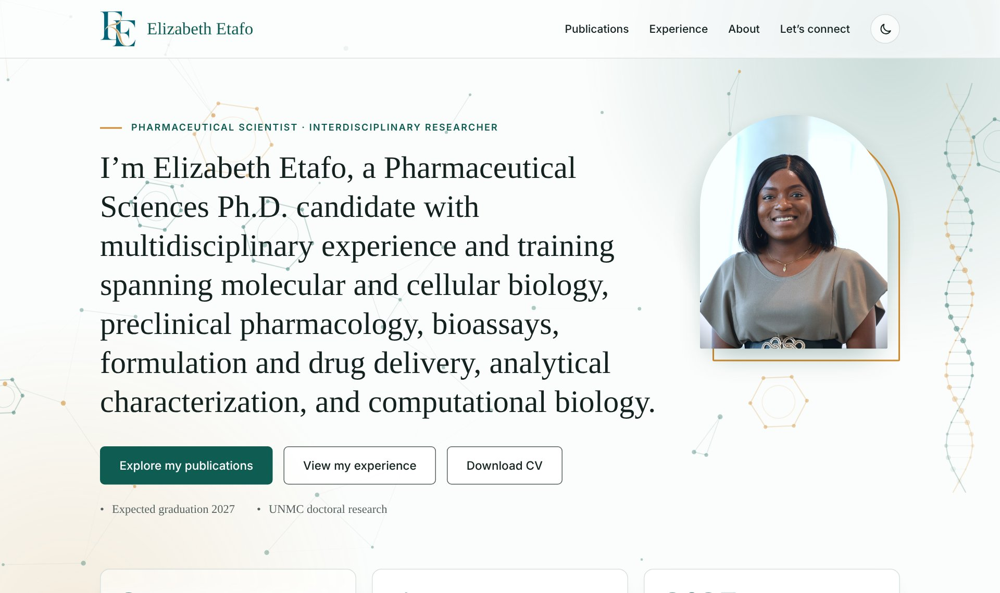

# Elizabeth Etafo | Research Portfolio

**🌐 Live site: [elizabethetafo.com](https://elizabethetafo.com)**

The personal research portfolio of **Elizabeth Etafo**, a Ph.D. candidate in Pharmaceutical Sciences at the University of Nebraska Medical Center. My research spans neuroimmunology, HIV, preclinical pharmacology, drug delivery, and computational biology.

[](https://elizabethetafo.com)

---

## 📄 What's on the site

| Page | What you'll find |
|---|---|
| [**Home**](https://elizabethetafo.com) | Introduction, education, and research highlights |
| [**Publications**](https://elizabethetafo.com/publications.html) | Peer-reviewed papers, awards and honors, and conference presentations |
| [**Experience**](https://elizabethetafo.com/experience.html) | Doctoral research projects and laboratory and computational skills |
| [**About**](https://elizabethetafo.com/about.html) | Background, leadership, training, and certifications |
| [**Let's connect**](https://elizabethetafo.com/contact.html) | LinkedIn, research profiles, and a downloadable CV |

## ✨ Features

- **Responsive design** that works on phones, tablets, and desktops
- **Light and dark mode**, which follows your device setting and remembers your choice
- **Animated molecular-style background** in plain JavaScript
- **Downloadable CV** on every main page
- **Link previews** with a custom image when the site is shared on LinkedIn or social media
- **Accessible**, with descriptive image text, keyboard-friendly navigation, and screen-reader labels

## 🛠️ Built with

- **HTML, CSS, and JavaScript**, with no frameworks or build tools
- **Google Fonts:** Newsreader and Inter
- **Hosted on GitHub Pages** with the custom domain `elizabethetafo.com`

## 📁 Project structure

```
├── index.html          # Home page
├── publications.html   # Publications, awards, and presentations
├── experience.html     # Research experience and skills
├── about.html          # Background, training, and certifications
├── contact.html        # Contact and research profiles
├── 404.html            # Page-not-found page
├── styles.css          # All site styling, including light and dark themes
├── script.js           # Theme toggle, counters, and page interactions
├── background.js       # Animated background
├── CNAME               # Custom domain setting for GitHub Pages
└── assets/             # Photos, logos, icons, and CV (PDF)
```

## 📫 Contact

- **LinkedIn:** [linkedin.com/in/eetafo](https://www.linkedin.com/in/eetafo/)
- **Google Scholar:** [Profile](https://scholar.google.com/citations?user=1YVLZ8gAAAAJ&hl=en)
- **ORCID:** [0009-0003-0752-5029](https://orcid.org/0009-0003-0752-5029)

---

© 2026 Elizabeth Etafo. All content, photos, and the CV are personal and may not be reused without permission.
